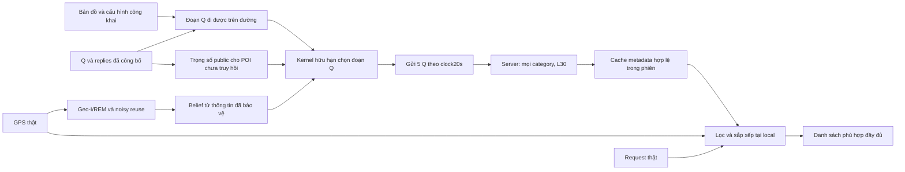

# Geo-I: bản cân bằng giữa bảo đảm toán học và chất lượng dịch vụ

Mục tiêu là một phương pháp có bảo đảm đúng phạm vi, utility sử dụng được và
trade-off có thể giải thích. Không cần thắng mọi metric. Tuy nhiên, kết quả tốt
ở nhiều metric không tự nó là overfit; nguy cơ xuất hiện khi dùng TEST để chọn
mẫu, thay cấu hình hoặc sửa kết luận. Một kết quả yếu cũng không được quy cho
“data generated” nếu chưa xác định lỗi dữ liệu cụ thể.

Giữ Geo-I/REM, noisy reuse và cap **Cs=0,23 m⁻¹ mỗi phiên**; không có cap tám
phiên. Giữ K=5, L=30 mỗi category, gửi theo clock20s, chọn chung đoạn ba khung
mỗi60s và ngân sách Q **Γ=1**. Thay đổi mới là cache local tích lũy metadata
hợp lệ và exploration công khai, giúp Q không bị khóa bởi pool của một khung.

## 1. Cơ chế và thông tin được phép dùng

GPS, Z, belief, ψ, điểm số và private ledger không đi vào request server.
Cache dùng mọi replies nhận được, không chỉ POI người dùng quan tâm. Request
không trigger fetch thêm, early stop hoặc thay K/L. Sorting dùng GPS/request
local; top-5 chỉ dùng cho metric, không là giới hạn output của ứng dụng.

Bản mới không đòi pool của từng khung chứa pool khung trước. Nó đòi **cache
đã nhận không mất metadata còn hợp lệ**. Library và public masses được tính
từ map, các Q giả đã lấy mẫu và replies. Chỉ bounded scores nhận belief Geo-I.

## 2. P1 — Base phân phối thích nghi công khai không tiêu thêm privacy

Điều kiện cùng prefix tăng cường H: gồm hành động Q ngẫu nhiên đã được bảo
vệ, nhãn lane giả và replies server; không gồm GPS/Z/belief. Nhãn lane cần
cho chứng minh vì các lane có thể cùng tọa độ nhưng dẫn tới support khác nhau.
Transcript server thực tế là phép chiếu của transcript tăng cường này.

Thư viện A(H), cache U(H) và số POI mới dự kiến d_a(H) đều cố định khi H cố
định. Đặt **η=4**, một hệ số công khai không có đơn vị:

\[
m_a=1+\eta d_a>0,\qquad w_a=\frac{m_a}{\sum_cm_c}.
\]

Không dùng GPS, ψ, belief hoặc nhãn train/test để tạo/prune A hay m. Dừng
lại tại Q hiện tại luôn khả thi; support không rỗng. Các paths theo mục tiêu
công khai và8 hướng công khai đều phải đi được trong20s mỗi khung.

Với integer score F_a∈{0,…,S}, S=65536, allowance ε_j=Γ/[j(j+1)]:

\[
z_a=F_a/S,\quad\mu=\sum_aw_az_a,\quad
\alpha_j=\frac{\varepsilon_j}{2+\varepsilon_j},\qquad
p_a=w_a[1+\alpha_j(z_a-\mu)].
\]

Σp=1, p_a>0 và với mọi hai private histories E,E′ tại cùng H:

\[
\boxed{\frac{p_a(E,H)}{p_a(E',H)}\le
\frac{1+\alpha_j}{1-\alpha_j}=1+\varepsilon_j.}
\]

w_a có thể rất khác nhau giữa actions, nhưng **cùng w tại cùng H**, nên
triệt tiêu trong tỷ số. Base ưu tiên thêm POI vì đã nhìn replies công khai;
việc này không tiêu một privacy budget mới. Không đúng nếu cache chỉ chứa
POI đã lọc theo ψ hoặc support được prune theo GPS chưa bảo vệ.

Viết α=N/D, M=Σm, lấy mẫu đúng các integer interval có độ dài:

\[
W_a=m_a[DMS+N(MF_a-\sum_cm_cF_c)],\qquad
T=\sum_aW_a=DM^2S.
\]

T không phụ thuộc F ở cùng H; randomness mặc định dùng OS bits, giả thiết
đều/độc lập. Simulator PCG và bộ Geo-I float không được gọi là đã chứng nhận
pure DP của toàn thiết bị. Chứng minh PMF không cần belief là posterior đúng
hoặc floating-point score chính xác, chỉ cần score integer bị chặn.

## 3. P2 — Toàn transcript và giới hạn suy luận

Chain rule trên H, sau đó lấy phép chiếu xuống wire, cho mọi fixed public
context C và hai quỹ đạo X,X′:

\[
\frac{P(O=o\mid X,C)}{P(O=o\mid X',C)}
\le R_n=\prod_{j=1}^n(1+\varepsilon_j)\le e^\Gamma.
\]

Replies phải là một kênh public-service chỉ phụ thuộc query và public/provider
world, không âm thầm dùng GPS/ψ thật. Cache/sorting local là hậu xử lý;
request/retry/close theo lịch đã khai báo, không tạo một observable branch
private mới. Bộ đếm Q persist qua restart và reserve trước khi công bố;
không refund allowance theo private score. Checkpoint cache phải được tin cậy,
khớp cùng public session/catalogue và không rollback.

Γ1,11 selections ở0–600s có R11≈2,234257. Bound mọi thời lượng:

\[
R_\infty\le\frac{R_{11}}{1-1/12}
=\frac{10763282027953}{4415938560000}\approx2{,}437371.
\]

Chứng minh tail dùng tổng allowance sau11≤1/12 và elementary symmetric sums
bậc k≤(1/12)^k; không giả sử các bước độc lập. Nếu upstream Geo-I lý tưởng
thỏa Cs·D∞, cùng đầu ra còn có cận:

\[
\boxed{\log\frac{P(O\mid X,C)}{P(O\mid X',C)}
\le\min\{C_sD_\infty(X,X'),\log R_n\}.}
\]

**Bound chặt hơn cho thay đổi muộn.** Core phải causal: E_t chỉ dùng
GPS đã có tới t; destination tương lai/ψ chỉ đi vào utility local. Nếu hai
histories giống nhau trước τ, các segments chọn trước τ có cùng law, kể cả
những khung được gửi sau τ. Gọi J=1+ceil(τ/60) là selection đầu có thể bị
ảnh hưởng, N là selection cuối được công bố. Khi J≤N:

\[
\boxed{R_{J:N}=\prod_{j=J}^{N}(1+\varepsilon_j),\qquad
\log R_{J:N}\le\Gamma\left(\frac1J-\frac1{N+1}\right).}
\]

Ví dụ τ=200s,J=5,N=11: odds multiplier≤1,1224 và posterior với prior50/50
≤0,5289. Nếu **chỉ fix cuối600s** khác, multiplier≤133/132≈1,00758. Đây
là fixed-comparison/shared-prefix guarantee; endpoint semantic thường thay
đổi cả một đoạn đường, nên không gán bound133/132 cho mọi S10. Identity
khác ngay đầu phiên vẫn dùng full R_n. Không publish bound chọn theo GPS
ẩn cho một wire cụ thể; generic R_n vẫn là bound quan sát mặc định.

Geo-I cho bảo đảm theo khoảng cách; lớp Q thêm giới hạn odds toàn phiên.
Không cộng Cs với Γ vì khác đơn vị và đây là hai cận của cùng đầu ra.
Nhiều phiên liên kết vẫn cần composition; không tự reset privacy lịch sử.

Kết luận Bayes cần Markov assumption Y→X→O điều kiện C: target tác động
lên wire qua dữ liệu private X, không qua một explicit-ID/private-purpose
channel khác. Nếu người dùng chọn future route dựa trên kết quả đã công bố,
phải mô hình hóa tương tác đó riêng; không dùng bound của fixed trajectory
để khẳng định mọi hành vi tương lai đều được che giấu.

Identity người, identity phương tiện, future route và query purpose tương
quan với vị trí chỉ được bảo vệ theo **giới hạn tăng posterior odds**:

\[
\mathrm{odds}(Y=y:Y=y'\mid O,C)
\le R_n\,\mathrm{odds}(Y=y:Y=y'\mid C).
\]

Với prior đều cho hai hypotheses, posterior mỗi hypothesis≤0,7091 cho cả
phiên; prior mạnh vẫn có thể dẫn tới posterior cao. Không chứng minh “không
thể suy ra”, không ẩn account/IP/biển số hay private start/stop metadata khác.
ψ không được truyền trực tiếp; tương quan ψ–vị trí vẫn có thể gây suy luận.

## 4. U1 — Utility tại GPS thật, không cần belief calibrated

Gọi U_t là union POI metadata **đã thực sự nhận** đến t, cùng static catalogue
và validity contract. Cache update cho U_t⊇U_{t−1}⊇U_0. Với GPS x và request
ψ bất kỳ, Rψ(x) là reference top-k theo ranking/tie-break cố định; R rỗng là
N/A. Local sorting toàn bộ POI hợp lệ trong U cho:

\[
H_\psi(x,U)=\frac{|R_\psi(x)\cap U|}{|R_\psi(x)|}.
\]

Do inclusion:

\[
\boxed{H_{\psi_t}(x_t,U_t)\ge H_{\psi_t}(x_t,U_0)\quad\forall t.}
\]

Đây là actual-utility bound với **cùng GPS và request ở thời điểm t**, so với
control giữ nguyên initial Q cùng lần lấy mẫu. Không so H ở hai GPS khác nhau;
không đồng nhất với baseline Geo-I, không bảo đảm absolute Recall≥90%.

Bất đẳng thức pointwise vẫn đúng cho request thích nghi tại local. Lấy kỳ
vọng có điều kiện và trung bình cả phiên giữ nguyên bound, không cần IID.
Public-reference weighted floor ban đầu cũng được giữ trong **cache**, vì
weights không âm; không cần từng khung Q riêng lẻ đạt floor đó nữa.

Nếu mọi POI còn thiếu không thể được trả trên các paths khả thi, guarantee
chỉ là không giảm utility của pool ban đầu. Không cam kết đạt toàn catalogue.
Truncated cuối phiên chỉ tính replies đã nhận; novelty score dự báo cả ba
khung là planning quantity, không phải số POI đã chắc chắn nhận trước close.

## 5. U2 — Vì sao exploration có ích và giới hạn của bound

Với public base w∝1+ηd và uniform base trên cùng library, tính chính xác:

\[
\boxed{\mathbb E_w[d]=\bar d+
\frac{\eta\operatorname{Var}_{uniform}(d)}{1+\eta\bar d}\ge\bar d.}
\]

Base ưu tiên potential coverage mới mà không tiêu privacy của protected
score. Với score z, finite tilt còn có E_p[z]=E_w[z]+α Var_w(z)≥E_w[z].
Với raw planning V và quantizer đơn điệu, gain=α Cov_w(V,z)≥0. Các gains này
là **điều kiện cùng prefix/support**; không chứng minh trajectory Γ1 tốt hơn
trajectory Γ0 có lịch sử/cache khác. So sánh đó cần benchmark controls.

**Giới hạn downside không cần calibrated belief.** Với bất kỳ actual
utility h_a∈[0,1], tại cùng prefix/support/public base:

\[
|\mathbb E_p[h]-\mathbb E_w[h]|\le\mathrm{TV}(p,w)
=\frac\alpha2\mathbb E_w|z-\mu|
\le\alpha\mu(1-\mu)\le\frac\alpha4.
\]

Vì z∈[0,1], E|z−μ|=2E[(z−μ)₊]≤2μ(1−μ). Ở Γ1, selection đầu có
ε₁=1/2,α₁=1/5 nên downside của private reweighting≤5pp. Selection thứ hai
α₂=1/13 nên bound≤1,923pp; các selections tiếp theo nhỏ hơn. Bound đúng
ngay cả khi proxy sai hoàn toàn; không cần δ=0. Đây là distortion của
**một bước tại cùng realized prefix**, không là chênh lệch giữa hai policies
chạy cả phiên và tạo các cache/support khác nhau. Nó không áp trực tiếp cho
latency/cost chưa được chặn trong[0,1]. `conditional_utility_shift` ghi rõ scope.

**Gain thực tế có điều kiện theo sai số proxy.** Tại cùng support/prefix,
gọi h_a là actual utility, V_a là planning score, với certified uniform error
|h_a−V_a|≤δ. Do p_a−w_a=αw_a(z_a−μ):

\[
\boxed{\mathbb E_p[h]-\mathbb E_w[h]
\ge\alpha\left[\operatorname{Cov}_w(V,z)
-\delta\,\mathbb E_w|z-\mu|\right].}
\]

Chứng minh bằng tách h=V+(h−V), rồi chặn mỗi phần error theo absolute
value. Bound này chặt hơn trừ2δ không phụ thuộc α. Planning gain chỉ đủ
bảo đảm actual gain khi covariance vượt error margin; không gán δ=0 cho
GPS ngoài public reference domain. `conditional_actual_gain` trả None khi
chưa có δ được xác nhận; supplied δ chỉ tạo conditional certificate.
Trong study hiện tại calibration này **chưa được chứng nhận**.

Một cận coverage thật có thể chứng minh nếu có lower bounds công khai:
q̲ℓ,j≤Σ_{a trả POI ℓ ở các khung sẽ gửi}w_a, tại **mọi compatible prefix mà ℓ
chưa được nhận**. Vì p_a≥(1−α_j)w_a, cho fixed private trajectory/request:

\[
P(\ell\notin U_J\mid X,C)
\le\prod_{j=1}^J[1-(1-\alpha_j)\underline q_{\ell,j}].
\]

Lấy kỳ vọng indicator của từng ℓ∈R rồi cộng cho cận expected Recall. Không
cần IID, nhưng không thay q̲ bằng một average score thuận lợi. Hiện q̲ toàn
mạng **chưa chứng nhận**; nếu reachable probability có thể bằng0 thì cận
trở nên vacuous. Không gán sai số belief/proxy bằng0 để tạo absolute-QoS claim.

## 6. Validity của cache và ranh giới lý thuyết

Session cache dùng metadata ổn định: POI ID, tọa độ, category/ranking fields
với hợp đồng còn hợp lệ. Không mở rộng TTL của opening hours, availability,
price, routing congestion hoặc status động. Nếu stale POI lọt vào top-k,
ranking lemma có thể sai: chỉ thêm items không còn chắc chắn tăng Recall.

Để dùng dữ liệu động phải thêm validation/expiry/revalidation đúng contract,
rồi chứng minh lại utility trên valid cache. Không dùng prototype này để
khẳng định giải xong freshness của mọi LBS. Privacy P1/P2 vẫn cần cache để
chọn support/masses là hàm của transcript public; raw GPS/request không được
quyết định refresh/packet schedule.

Cache/session-mask bị chặn bởi số POI catalogue; không tăng vô hạn theo số
bước. Mask418 POI chiếm418 bytes NumPy boolean, không phải tổng RAM hay tổng
metadata/network cost. Toàn graph, public score tables và planner caches vẫn
phải tính riêng. Snapshot chỉ giữ metadata received; checkpoint/retry không
gửi query mới và không reset Q budget.

Catalogue có thể bulk download thì full-catalogue local ranking là control
cần thiết và có thể bỏ tọa độ queries. Kết quả ở đây chỉ áp dụng contract
point-query có cùng K/L. Không nói cache là đóng góp riêng của Geo-I hoặc
vượt mọi phương pháp trên metadata đã được cung cấp toàn bộ offline.

## 7. Đánh giá bản cân bằng

Ưu tiên hard requirements: P1/P2, paths có hướng, no private-purpose channel,
persistent budget/cache và U1 được kiểm tra. Sau đó dùng actual utility,
attack errors và cost để mô tả Pareto trade-off. Γ1 là primary chọn trước;
Γ0 và public-prior kiểm tra gain nào đến từ retrieval/cache, không từ Geo-I.

Protocol mới giữ gate cũ−2pp so với baseline ở từng purpose và macro để
báo cáo mức noninferiority. Riêng “balanced research candidate” đặt trước
mean macro≥90% và mean từng purpose≥80%, kèm toàn bộ CI. Đây là mức utility
nghiên cứu có thể thảo luận, không là một mathematical lower bound, không
thay gate cũ trên những kết quả đã xem và không tự promote production.

Cohort v1 cần60 groups nhưng public geometry chỉ cung cấp49 sau khi loại144
nhóm đã dùng. Không benchmark defense trên v1. V2 đóng băng riêng với48
groups20 TRAIN/8 SELECTION/20 TEST, giữ geometry seed/route eligibility;
nhãn và sampler secrets không được công bố. Có176 evaluated trip-draws,
120 TEST, ba private draws/trip TEST. Đây là synthetic cùng map/generator,
không phải real-device hay cross-city. Smaller selection/test làm CI và
attacker selection kém chắc chắn hơn; không coi đó là lý do bỏ kết quả xấu.

## 8. Định lý → giả thiết → cơ chế → kiểm tra

| Kết quả | Giả thiết cần | Mã/kiểm tra |
|---|---|---|
| P1 integer PMF và common support | public prefix tạo A,m; bounded F; uniform bits | `CacheExplorePolicy`, exact integer oracle |
| P2 full transcript | augmented Q state + replies; public provider law/clock; trusted ledger | `PersistentQueryBudget`, frozen independent audit |
| U1 actual Recall≥initial | static valid metadata; stable ranking/ties; mọi replies được cache | `SessionCoverClient`, rebuild cache và exact local utility |
| U2 public novelty gain | positive public masses1+4d | exact Fraction mean/variance identity |
| Downside của private adaptation | cùng prefix/base; bounded actual utility[0,1] | exact TV và mọi utility vertices trên oracle hữu hạn |
| Belief planning gain | finite V; monotone quantizer; cùng support | covariance certificate, Γ0/prior controls |
| Restart/retry | same context/checkpoint; không rollback | JSON checkpoint, idempotent retry, budget prefix tests |
| Absolute QoS | certified reachability/proxy error bounds | chưa chứng nhận; benchmark không thay bằng theorem |
| Dynamic freshness | validation/status contract đúng | chưa triển khai trong bản static metadata này |

[Chứng minh trước](2026-10-12_finite_privacy_utility.md) và [hai trials trước](2026-10-12_finite_progress_results.md)
được giữ nguyên. [Protocol mới](../../artifacts/benchmarks/cache_balance_20261012_v2/protocol.json)
và [bản thất bại trước khi benchmark](../../artifacts/datasets/cache_fresh_native_20261012_v1/generation_failure.json)
được ghi riêng, không thay thế lịch sử.
