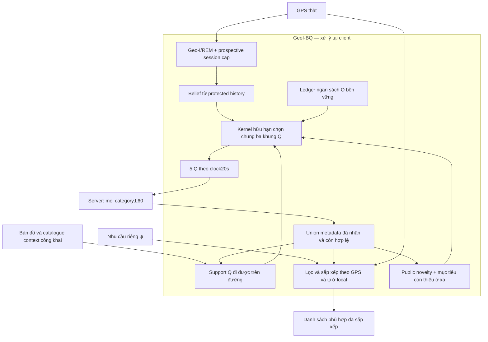

# GeoI-BQ — phiên bản tham chiếu cho mô hình nghiên cứu

GeoI-BQ giữ Geo-I/REM và ngân sách riêng tư từng phiên, bổ sung một kênh Q
có cận suy luận toàn phiên. POI được lấy bằng request chung; GPS và nhu cầu
thật chỉ dùng để lọc, sắp xếp ở local. Bản này giới hạn các giả thiết để
chứng minh được, rồi dùng benchmark xác nhận trade-off trong phạm vi đó.

## 1. Thuật toán được chốt

| Thành phần | Cấu hình / ý nghĩa |
|---|---|
| Geo-I/REM | B=0,24m⁻¹,H=12,u=0,01m⁻¹; cap hiệu dụng Cs=0,23m⁻¹ mỗi phiên |
| GPS đi vào Geo-I | tối thiểu60s giữa hai lần private read; noisy test θ200m; slack0,03 |
| Belief | dự đoán từ protected history; không yêu cầu là posterior calibrated |
| Q | K=5; ba khung chọn chung tại0/20/40s; đoạn tiếp theo mỗi60s |
| Ngân sách Q | Γ=1,ε_j=Γ/[j(j+1)]; ledger persist, không reset trong cùng phiên |
| Response depth | L60 **mỗi category** cho mọi Q, chọn trước từ thiết kế công khai |
| Public planner | public portfolio beam24; noveltyη4; long-range potentialη4; travel scale60s |
| Kernel | finite centered tilt,score resolution65536; default fresh OS bits |
| Utility local | cache metadata ổn định còn hợp lệ; trả danh sách phù hợp đầy đủ đã sắp xếp |

K5 là số query slots, **không phải k-anonymity**. Với C categories, mỗi khung
nhận tối đa5×60×C records trước khi loại trùng; không mặc định nhận300 POI
unique. Recall@5 chỉ là metric đánh giá, không là giới hạn output cho người dùng.



**Luồng một bước:** tới mốc private read, Geo-I kiểm tra bằng noisy test và
reuse hoặc tạo Z mới trong cap. Belief cập nhật/predict từ thông tin đã bảo
vệ. Tới mốc60s, public library tạo những đoạn Q hợp lệ: giữ nguyên, tiến tới
public goals, khám phá vùng lân cận và tiến tới POI chưa nhận ở xa. Điểm
belief chỉ thay trọng số trong kernel bị chặn; không loại candidate.
Ledger commit trước khi gửi. Tại20/40s gửi khung đã chọn, không lấy mẫu lại.
Replies được union/cache; ψ không ảnh hưởng packet/category/depth/cadence.

**Vì sao thêm long-range goals?** Chỉ ưu tiên POI mới trong vùng đi được
20s có thể mắc ở nơi đã được phủ hết. Goal xa được chọn theo gain/(1+travel/60),
với năm thứ tự phân công public cho năm tracks. Potential của goal tăng
public mass của đoạn dẫn tới nó; đây là planning potential, không hứa chắc
đã nhận các POI đó hay sẽ hoàn tất một tour. Hold luôn khả thi.

## 2. Vì sao L60, và bảo đảm nào là thật

L được thiết kế từ bản đồ/catalogue và36 public states, bốn purposes cùng
chín destination prototypes. Không đọc GPS hoặc benchmark scores để chọn L.
Tính **exact semantic reference masses bằng Fraction**, chia đều states,
những purposes/destinations/categories có reference; N/A không là score0.
Chọn smallest tested L trong{30,40,50,60} có public beam goal đạt99% mean
reference Recall. Chỉ giữ những initial goals đạt floor này.

| L mỗi category | Best exact-public mean Recall,hiển thị (%) | Initial goals đạt99% |
|---:|---:|---:|
| 30 | 93,727 | 0 |
| 40 | 96,651 | 0 |
| 50 | 98,401 | 0 |
| 60 | 99,351 | 24 |

Đây là minimum trong **frontier/beam đã khai báo**, không là optimum toàn
mạng. Chứng chỉ cho **trung bình trên miền tham chiếu công khai**, không
bảo đảm99% cho mọi GPS thật, category, radius hoặc destination. Công thức
weighted reference mass là đúng tỷ lệ items của các reference sets đã
truy hồi; vì cache chứa initial pool, floor này tiếp tục giữ trên miền đó.

Tăng L không tăng Γ hay cap Geo-I. Provider responses là một common
postprocessing channel của Q; planner bước sau vẫn dùng common public
support/masses. Với **cùng Q stream**, trả top60 thay vì top30 cho union
superset và không giảm Recall tại cùng GPS/request. Nếu planner được chạy
lại theo replies sâu hơn, Q có thể đổi: không suy ra một ordering giữa hai
whole policies chỉ từ superset lemma.

L60 tăng ngân sách dữ liệu phản hồi. So sánh baseline/ablations trong trial
mới đều dùng L60, cùng cache và cadence. Giữ nguyên trial L30 để không
biến utility gain do response depth thành claim rằng mọi thuật toán khác kém.

[Thiết kế công khai](../../artifacts/benchmarks/public_depth_design_20261014_v1/certificate.json).

## 3. Những phát biểu toán học có thể dùng trong thesis

**Privacy toàn phiên.** Với augmented sampled fake-lane/segment history
cố định, support và positive public masses w chung. Gọi s_a=F_a/65536∈[0,1],
μ=Σw_as_a,α_j=ε_j/(2+ε_j). Kernel p_a=w_a[1+α_j(s_a−μ)] có PMF exact
integer và p_a(X)/p_a(X′)≤1+ε_j. Do chain rule và projection xuống wire:

\[
\frac{\Pr(O\mid X,C)}{\Pr(O\mid X',C)}
\le R_n=\prod_{j=1}^n(1+\varepsilon_j),\qquad
R_\infty\le2{,}437371\quad(\Gamma=1).
\]

Trong ideal Geo-I upstream, extended test/anchor history chịu prospective
integer-cost cap; toàn wire còn có log-ratio≤min{Cs·D∞,logR_n}.
Không cộng Cs với Γ vì khác đơn vị. S4 liên kết **người/thiết bị/phương tiện**,
S5 next step, S6 future destination và suy luận intent chỉ nhận posterior-odds
bound khi target→private trajectory→wire với common context. Account/IP/
biển số, prior mạnh, các phiên liên kết hoặc target sinh từ output cần phân
tích riêng; không nói “không thể suy ra”.

**Utility tại GPS thật.** Với metadata còn hợp lệ,U_t⊇U_0 nên Recall của
local sorted answer ở cùng GPS/request tại t≥control giữ initial pool của
**chính lần lấy mẫu đó**. Không yêu cầu belief đúng, không so hai GPS khác
nhau và không mặc định absolute Recall≥99% ngoài public domain.

**Utility cả phiên khi belief sai.** W là **cùng planner** với public base
Γ0. Conditional χ² một bước≤α_j²/4; likelihood-ratio second moment và tower
property cho toàn adaptive path, không cần IID:

\[
\left|\mathbb E_{P_\Gamma}[h]-\mathbb E_W[h]\right|
\le\frac12\sqrt{\prod_j(1+\alpha_j^2/4)-1}
\le0{,}0553\quad(\Gamma=1,\ h\in[0,1]).
\]

Cận **5,53pp** áp cho bất kỳ bounded actual Recall của một bước/cả phiên,
so với matched public-base policy. Nó không nói Geo-I belief chắc chắn tăng
Recall, không áp sang baseline có support khác. Rational prefix/tail và
integer square-root ceiling tạo chứng chỉ, không dựa vào square-root float.

[Chứng minh chi tiết và giả thiết → mã → kiểm tra](2026-10-14_whole_session_utility.md).

## 4. Benchmark của phiên bản tham chiếu

Trial được đóng băng trước lượt randomness mới. Native GPS giữ nguyên:
48 families,20 TRAIN/8 SELECTION/20 TEST;176 evaluated trip-draws,120 ở
TEST với ba draws/trip. **Geometry/GPS này đã được đánh giá trước**: đây
là stochastic stability replication, không là cohort quỹ đạo mới hoặc
cross-city confirmation. Không đổi GPS, bỏ purpose hay chọn private samples
để đạt score. Source snapshots/protocol/input hashes được giữ.

Trong bảng dưới, các phương án K5 đều dùng **L60**, cùng protected Geo-I
history từng trip, cadence/cache/local ranking. Geo-I Z K1 là controlled
post-hoc ablation: chính protected Z được gửi theo natural single-point
contract; không resample Geo-I và dùng cùng attacker-selection protocol.
Không coi benchmark các output styles khác nhau là cùng chi phí.

| Phương án | Macro Recall@5 (%) | Gần nhất | Nhanh nhất | Trong bán kính | Ít vòng đường |
|---|---:|---:|---:|---:|---:|
| Geo-I/REM: Z trực tiếp K1 | 99.700 | 99.753 | 99.753 | 99.625 | 99.668 |
| Geo-I + service-cover K5 | 100.000 | 100.000 | 100.000 | 100.000 | 100.000 |
| Giữ initial Q K5 | 98.377 | 98.984 | 98.987 | 96.358 | 99.181 |
| Geo-I + local exploration K5 | 99.562 | 99.609 | 99.609 | 99.358 | 99.670 |
| Public-base control Γ0 K5 | 99.711 | 99.730 | 99.731 | 99.642 | 99.740 |
| **GeoI-BQ Γ1 K5** | 99.595 | 99.638 | 99.641 | 99.388 | 99.712 |

Primary **99,595%**, family-bootstrap95%CI **[99,225;99,902]%**.
So với K5 service-cover baseline100%,Δ **−0,405pp**,CI[−0,775;−0,098]pp.
Gate đã chọn trước yêu cầu lower CI≥−2pp cho macro và **từng purpose**,
và mean từng draw≥−2pp: **đạt**. Purpose yếu nhất trong gate là radius,
lower CI−1,331pp. Đây là noninferiority trong protocol đã kiểm tra, không
phải bằng nhau hoặc vượt baseline về utility, không là population theorem.

So với bare Geo-I Z K1:Δ macro−0,105pp,CI[−0,536;+0,273]pp. Point-query
cost khác nhau; lợi thế của Q thể hiện ở privacy cả phiên và road-valid
fake paths, không phải thắng một utility/cost comparison với K1.

So với static initial Q K5: **+1,218pp**,CI[+0,302;+2,412]pp. Long-range
so với local exploration ở L60 chỉ+0,033pp,CI[−0,109;+0,178]pp: **không có
xác nhận một gain riêng trong trial L60**. Trial L30 giữ riêng:96,090% so
với local95,516%,Δ+0,574pp,CI[+0,193;+1,002]pp, nhưng chưa đạt gate−2pp.
Không đổi config primary sau khi đọc TEST để chọn arm có số cao nhất.

**Γ0 control đạt99,711%**, hơn primary0,116pp,CI của primary−Γ0
[−0,253;−0,006]pp. Private belief adaptation không đem actual-utility gain
trong static catalogue này. Giữ Geo-I để có spatial/event privacy profile
và một nguồn protected belief; không gọi Γ1 là Pareto optimum hoặc nói
Geo-I là nguyên nhân của mọi retrieval gain.

### Privacy: baseline Geo-I thật và vai trò kênh Q

Mỗi ô **Hit100 (%) / MAE (m)**, với attacker được chọn riêng cho từng loss
trên SELECTION. Bank gồm **ExtraTrees64**, **kNN1/kNN5** và public geometry;
endpoint thêm ordered-track/sequence models. Không mặc định cùng một attacker
cho mọi scenario/model. Lower Hit và higher MAE có lợi cho privacy.

| Scenario | Geo-I/REM Z K1 | Geo-I service-cover K5 | GeoI-BQ K5 |
|---|---:|---:|---:|
| S1 | 18.522% / 338.5 | 0.430% / 1145.8 | 0.188% / 2104.6 |
| S2 | 37.500% / 214.3 | 0.833% / 1001.2 | 0.000% / 2124.2 |
| S3 | 18.522% / 338.5 | 0.484% / 1000.1 | 0.188% / 2104.6 |
| S9 | 5.833% / 435.8 | 0.000% / 953.7 | 0.000% / 1986.4 |
| S10 | 35.000% / 246.8 | 0.000% / 1018.7 | 0.000% / 2124.2 |

Ví dụ S10: baseline gửi Z có Hit10035%,MAE246,8m; GeoI-BQ có0%,2124,2m.
0% ở finite sample không nghĩa probability0. Service-cover baseline cũng
có0% endpoint Hit; MAE và controlled raw-Z ablation mới phân biệt rõ hơn.
Mathematical privacy/attacker bound không phụ thuộc bank hiện tại tối ưu.
S2 chỉ là parked-coordinate proxy; chưa là clinical/semantic-place classifier.
S4–S6 chỉ là conditional mathematical inference assessment, chưa có identity
hoặc future-prediction empirical benchmark mới.

### Chi phí và những nguồn utility gain

| Phương án | Point requests/trip | Reply serialization (KB) |
|---|---:|---:|
| Geo-I Z K1 | 31 | 16.921 |
| Geo-I + service-cover K5 | 155 | 85.268 |
| Public-base control Γ0 K5 | 155 | 83.442 |
| **GeoI-BQ Γ1 K5** | 155 | 82.557 |

Primary khoảng82,557KB, so với L30 targeted trial48–49KB; không phải free
utility gain. K1 Z khoảng16,921KB với31 requests: Q phải trả thêm traffic
để có global inference cap và fake-route continuity. Những bytes này là
**JSON POI indices**, chưa gồm record metadata thật, HTTP/TLS, latency,
battery hay toàn RAM của planner. Không dùng chúng làm total deployment cost.

Giữ **cùng primary Q stream**, truncate provider L60→L30 cho Macro94,170%,
so với L60 99,595%: gain+5,425pp,CI[+3,486;+7,527]pp. Đây là controlled
response-depth effect, **không là một L30 policy chạy lại và thích nghi**.
Initial cache trung bình380,20/418 POI, cuối415,875/418. Metadata gần đầy
catalogue là nguyên nhân service tốt; không giấu dependence này.

### Local GPS freshness

Primary metric dùng native current fix mỗi20s ở **local ranking**; private
Geo-I updates vẫn chỉ mỗi60s hoặc khi filter cho phép. Đọc GPS local không
phải thêm privacy release, nhưng hardware/battery cost chưa đo.

Giữ cùng wire và chỉ giữ last60s local fix: primary Macro**95,348%**, baseline
K5**95,625%**;Δ−0,277pp,CI[−0,538;−0,065]pp. Radius primary89,514% vì
ranking/membership có thể sai khi dùng vị trí cũ; không áp99,595% vào contract
này. Mọi purpose ở sensitivity có lower paired CI≥−2pp, nhưng đây là
secondary held-fix readout, không thay main gate hoặc biến stale GPS thành
fresh-GPS theorem. U1 giả thiết cùng vị trí đúng để ranking/reference; nếu
vị trí ước lượng sai, cache inclusion không tự chứng minh true-location
Recall tăng. Cần error/margin assumptions riêng, không mặc định error0.

## 5. Có thể bảo vệ đến đâu và nên trình bày thế nào

- **S1–S3,S9–S10:** mathematical full-transcript/location profile và empirical
  coordinate metrics trong single-session/public-clock scope. Không tuyên bố
  timing, logs, semantic diagnosis hoặc mọi attacker đạt0%.
- **S4:** identity người/thiết bị và identity phương tiện là conditional latent
  inference targets. **S5/S6:** next step và planned destination tương tự.
  Ngoài posterior odds, mọi attacker có average prior-relative success gain
  ≤5,53pp; Γ1 có additional information bound<0,018bit. Prior mạnh/ID trực
  tiếp không được xóa. Target thực tế sinh từ public output cần mô hình riêng.
- **S7:** request type/category/radius/destination không truyền trực tiếp;
  bốn purposes được đánh giá, sorting full list local. Tương quan với GPS
  vẫn cần inference assumptions, không nói đã ẩn mọi query semantics.
- **S8:** multi-user co-location là scope mở rộng; cần joint accounting và
  đánh giá riêng, không claim giải xong bằng một single-session certificate.

Privacy ưu tiên mathematical conditions, không tối ưu một attacker riêng.
Utility/cost không bắt mọi aspect hoàn hảo: giữ negative controls và cận
necessary retrieval volume khi các regions có disjoint references. Không
suy rộng catalogue418 sang mọi city. Simulator dùng complete public catalogue
để xây/audit planner; nếu catalogue thực sự được cấp offline, bulk/local
ranking có thể đạt100% và không cần point queries. Trial chỉ xác nhận model
trong **declared point-query contract**, không chứng minh lợi thế thực tế
so với full-catalogue distribution. Opaque/dynamic metadata và catalogue lớn
cần xác nhận riêng trước khi có publication/deployment claim rộng.

## 6. Bản chạy và kiểm tra tái lập

[Manifest chính](../../configs/geo_i_bq_v1.json) ghim source/input/evidence,
[factory](../../core/research_release.py) ghép đúng Geo-I → bounded Q →
static cache; [runtime](../../core/bounded_query_session.py) persist ledger/
cache, replay committed frame sau lỗi, không resample hoặc cấp budget mới.
Mở lại phải có fully restored Geo-I engine; không chỉ tạo engine mới để
reset cap. Logical public-clock proof không là một hardware scheduler/timing
certificate. Các benchmark arms là views riêng; không gửi Z và Q song song.

```python
from core.research_release import create_model
model = create_model("/private/tmp/my-geoi-session", session_token="trip-001")
# model.step(lat, lon, public_timestamp_s, server=provider)
# model.session.local_answer(model.ranking, true_state, private_query)
# Chỉ provider request/reply là public; không gửi diagnostics/cache/ledger.
```

Hard audit:5,984 exact kernel selections;81,840 masks/actual utility được
rebuild/recompute;21,241 comparisons với matched initial pool. Replay từ
immutable source snapshot đã qua, không dùng private keys, resample hoặc
refit. Main manifest không đổi các lịch sử L30, default legacy engine hoặc
các thesis tables đã review. Đây là **research reference v1 trong scope đã
khai báo**, không là chứng nhận pure-DP của Geo-I float/PCG/hardware stack,
real-device validation hoặc publication acceptance.
